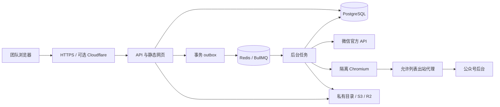

# 架构与业务约定

前端 React / Vite 同域调用 Fastify `/api/v1`。PostgreSQL 是业务进度的事实来源，Redis / BullMQ 只负责派发；浏览器独立进程，凭据只经受保护的内部接口传输。应用数据与二维码均不走公共 CDN 缓存。

## 获取与完整性

`OfficialApiAdapter`、`BackendBrowserAdapter` 和 `ArticleUrlAdapter` 共享分页清单协议。官方列表拆开每个 `news_item`，保留 `article_id:图文序号` 来源；账号内用平台标识合并，短链接通过页面标识和来源记录对齐。标题不是唯一键。

后台适配器在真实浏览器中进入发表记录，通过页面正常加载产生的响应读取结构化清单；无法读取时只收集页面公开的文章链接，并将覆盖标为未确认。只有结构化后台总发表数与遍历数吻合，且官方发现的条目也能与后台清单对齐，才将历史清单标为已核对。不能把此自动计数替代初次上线的人工历史核对。

`job.report` 保存渠道、发现数、成功数、失败数、缺图文章数和覆盖状态。后台失效但官方成功时任务可部分成功，下一次官方同步仍可运行；两个渠道均无法提供清单时等待授权。账号中原有存档不会因列表少项或文章删除而删除。

每日增量为保证发现范围仍遍历可用清单，但正文只处理新增、缺图、发布时间未知、最近 30 天或明确已删除条目。更早正文的修改 / 删除要通过“重新核对全部历史”检测。官方更新时间不会冒充发布时间。数据库 UTC，日期筛选和界面显示按 Asia/Shanghai。

## 数据与持久化

- 用户、会话、账号访问表：内部单工作空间，无公开注册、无多企业租户。
- 账号、两种连接：每账号官方凭据、令牌与浏览器状态独立加密，读取只返回状态。
- 文章、来源、版本：`account_id + platform_key` 唯一；`article_id + content_hash` 唯一；原始正文私有保存；更新保留历史版本。
- 资源、版本资源引用：按账号 + 文件 SHA-256 去重，资源缺失独立重试，不依据 Markdown 是否存在跳过。
- 任务、条目、checkpoint、outbox：事务创建后派发；分页 checkpoint 与每篇状态持久化。
- 导出及导出条目：创建时固定当前版本、Markdown、图片引用与清单状态；后来同步和图片修复不改已经创建的导出快照。

## 任务执行

状态：`queued → running → succeeded / partial / failed`；可进入 `paused / waiting_auth / cooldown / cancelled`。暂停或取消撤销租约，正在执行的网络请求可能先结束，但不会继续取新任务；已完成内容保留。

数据库的部分唯一索引阻止同一账号创建多个未结束同步任务；会话级 advisory lock 防止旧执行器尚未退出时新执行器接管。同一账号正文串行，全局最多两个任务。每 10 秒记录心跳；超过 2 分钟无心跳重新排队，重复投递必须重新领取租约。重试网络 / 临时服务错误最多 3 次；业务限制不循环重试。

官方分页可从 checkpoint 续跑。后台浏览器在分页过程中中断会重新枚举该账号清单，条目唯一约束保证无重复；当前浏览器扫描响应按一次完整扫描返回，不持久化浏览器 DOM 或执行栈。

下载与转换不使用 LLM。正文清理脚本、事件处理器、表单与广告节点；媒体转原文入口。图片验证 HTTPS 允许域名、每次重定向、所有 DNS 结果、字节上限、文件签名和实际解码。图片失败保留远程链接和错误说明。服务器正文 / 图片下载使用固定解析结果连接，防 DNS 重绑定。

## 限制

默认页面适配器仍须在目标账号上核验。公众号后台的账号选择页、验证流程和发表记录 DOM 不受本项目控制；异常时停止并报告，不实现验证码破解或反检测绕过。表情、图片背景、复杂多栏和嵌入组件转 Markdown 后可能失去原版布局；保留原始 HTML 供后续转换器修复，但界面只预览清理后的 HTML。

“图片齐全”只说明可识别且允许归档的图片资源状态；不支持的图片地址也会把资源状态标为缺失。音视频只保留说明和原文链接，未下载二进制媒体。
